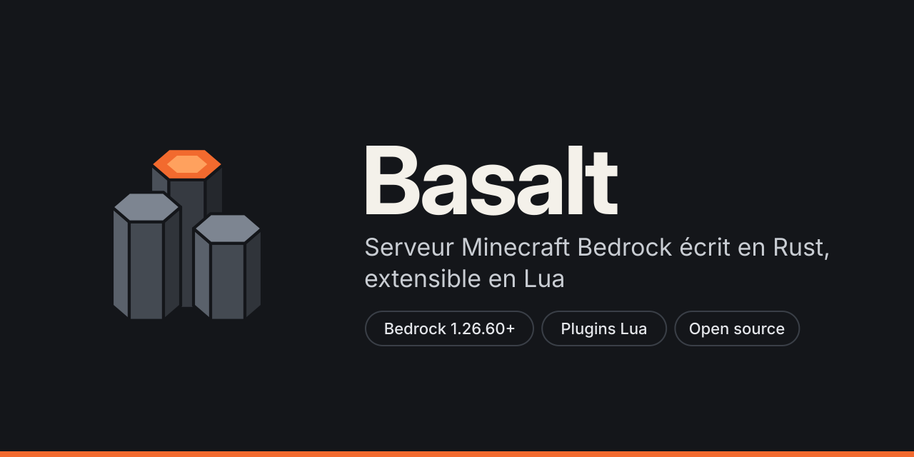

<p align="center"></p>

<p align="center">
  <a href="https://github.com/ZoumiSurGithub/basalt/releases"></a>
  <a href="https://github.com/ZoumiSurGithub/basalt/releases/latest"></a>
  <a href="https://discord.gg/dc7evQZ77u"></a>
  <a href="LICENSE"></a>
  <br>
  <a href="docs/RESEAU.md#versions-du-jeu-acceptées"></a>
  <a href="docs/RESEAU.md#versions-du-jeu-acceptées"></a>
</p>

# Basalt

Un serveur **Minecraft Bedrock** écrit en Rust, dans l'esprit de PocketMine-MP : un seul
exécutable, un fichier `server.properties`, une console, et des plugins en Lua.

Basalt est un projet jeune (version 0.0.x), déjà jouable avec le vrai jeu : il est essayé
avec Bedrock 1.26.60 et plus sous Windows, avec des comptes Xbox vérifiés.

| | Version de Bedrock | Protocole |
|---|---|---|
| **Dernière version prise en charge** | 1.26.70 (préversion) | 2259 |
| Dernière version stable | 1.26.60 à 1.26.66 | 2225 |

Les joueurs de ces versions peuvent être connectés en même temps ; les versions antérieures
à la 1.26.60 sont refusées. Détails dans [docs/RESEAU.md](docs/RESEAU.md#versions-du-jeu-acceptées).

**Une question, une idée, un bug ? Rejoignez le [Discord](https://discord.gg/dc7evQZ77u).**

## Pourquoi choisir Basalt

- **Rien à installer autour.** Un exécutable et c'est tout : ni Java, ni PHP, ni base de
  données. L'installation tient en une commande, la mise à jour aussi.
- **Léger.** Avec 1 000 joueurs simulés, le serveur occupe 7 Mo de mémoire et 14 % d'un
  cœur, à 20 ticks par seconde (mesure sur une machine de 2 cœurs, détaillée dans
  [docs/PERFORMANCES.md](docs/PERFORMANCES.md)).
- **À jour avec le jeu.** Basalt parle NetherNet, le transport que Bedrock exige depuis la
  1.26.60 ; un serveur qui ne parle que RakNet affiche une erreur à ces joueurs.
- **Un monde qui ressemble au jeu.** Une cinquantaine de biomes, des grottes, des villages
  habités, des temples, des épaves, des manoirs, avec le butin de leurs coffres.
- **Des plugins simples à écrire.** En Lua, avec des événements à la PocketMine, un guide
  pour ceux qui n'ont jamais programmé et des exemples prêts à copier.
- **Sûr par défaut.** Comptes Xbox vérifiés, liaison chiffrée, déplacements, fabrication et
  échanges contrôlés par le serveur, limites contre les paquets malveillants.
- **Des sauvegardes minuscules.** Le terrain se régénère à partir de la graine : seuls les
  blocs modifiés par les joueurs sont enregistrés.
- **Libre.** Licence MIT, code et documentation en français.

## Ce que fait Basalt

| | |
|---|---|
| **Connexion** | NetherNet et RakNet, comptes Xbox vérifiés, liste des serveurs, plusieurs versions du jeu en même temps |
| **Monde** | terrain à la manière du jeu (relief, biomes, grottes, arbres, fonds marins), cycle jour et nuit, eau et lave qui coulent, sauvegarde |
| **Structures** | villages, pyramides, temples de la jungle, mines abandonnées, avant-postes, cités antiques, ruines de piste, chambres des épreuves, épaves, igloos, portails en ruine, manoirs |
| **Blocs** | casser et poser (escaliers, orientations, dalles), portes, trappes, portillons, leviers, coffres, fours, établi, cloches |
| **Joueurs** | visibles entre eux avec leur skin, survie, créatif, aventure et spectateur, combat avec recul, dégâts de chute, mort et réapparition |
| **Inventaire** | sac, armure, seconde main, menu créatif, fabrication et cuisson, objets au sol |
| **Animaux** | vaches, cochons, moutons, poules, lapins, chèvres, champimeuhs : élevage, croissance, tonte, traite |
| **Montures et compagnons** | chevaux, ânes, mules et lamas à apprivoiser, seller et charger ; loups et chats ; laisses |
| **Villageois** | métiers et postes de travail, emploi du temps, lits, naissances, échanges avec niveaux et réassort, golems de fer |
| **Commandes** | `/tp`, `/gamemode`, `/give`, `/summon`, `/setblock`, `/fill`, `/locate`, `/time`, modération, chat en couleur |
| **Plugins Lua** | événements, commandes, accès au monde, personnages non joueurs, générateurs de terrain ; EasyEdit et Archipel fournis |
| **Administration** | console, opérateurs, liste blanche, permissions, `status` et `timings` |

Ce qui reste à faire est suivi dans la [feuille de route](docs/ROADMAP.md).

## Installation

Le guide pas à pas, de l'installation à l'ouverture du serveur aux joueurs d'Internet, est
dans **[docs/INSTALLER.md](docs/INSTALLER.md)**.

**Linux, en une commande** (rien à compiler) :

```sh
mkdir basalt && cd basalt
curl -sSfL https://raw.githubusercontent.com/ZoumiSurGithub/basalt/main/get.sh | sh
./start.sh
```

Pour mettre à jour : `./update.sh`, puis redémarrez. La configuration, le monde et vos
plugins ne sont jamais touchés.

**Windows** : dans le dossier `windows`, double-cliquez sur `Installer.cmd`.

**Depuis les sources** : `cargo build --release`, avec Lua 5.4 installé pour les plugins.

Pour se connecter depuis le même ordinateur : dans Minecraft, *Jouer > Serveurs > Ajouter
un serveur*, adresse `127.0.0.1`, port `19132`.

## Écrire un plugin

Un plugin est un fichier `plugins/nom.lua`, ou un dossier `plugins/nom/main.lua`.

```lua
server.on("login", function(joueur)
  if joueur.name == "Griefer123" then
    return "Vous êtes banni."      -- un texte (ou false) refuse la connexion
  end
end)

server.command("bonjour", "dit bonjour", function(args)
  server.log("Bonjour " .. (args[1] or "tout le monde"))
end)
```

- **Jamais programmé ?** [Créer un plugin sans savoir programmer](docs/DEBUTER.md) part de
  zéro, avec cinq plugins prêts à copier dans [`docs/exemples`](docs/exemples).
- **Référence complète** : [docs/PLUGINS.md](docs/PLUGINS.md).

## Documentation

| Page | Contenu |
|---|---|
| [Installer Basalt](docs/INSTALLER.md) | Windows, Linux, connexion, ouverture à Internet, réglages |
| [Console, commandes et couleurs](docs/CONSOLE.md) | toutes les commandes, codes de couleur du chat |
| [Le monde](docs/MONDE.md) | terrain, eau et lave, structures, graine et type de monde |
| [Réseau et sécurité](docs/RESEAU.md) | versions acceptées, ports, protections, authentification Xbox, dépannage |
| [Performances](docs/PERFORMANCES.md) | mesures de charge, réglages pour un grand serveur |
| [Créer un plugin sans savoir programmer](docs/DEBUTER.md) | les bases du Lua et des exemples |
| [Plugins : la référence](docs/PLUGINS.md) | événements, commandes, minuteries, générateurs de terrain |
| [Développement](docs/DEVELOPPEMENT.md) | organisation du code, tests, publication d'une version |
| [Feuille de route](docs/ROADMAP.md) | ce qui est fait, ce qui reste à faire |
| [Journal des changements](CHANGELOG.md) | le détail de chaque version |

## Crédits

Le cœur de Basalt n'utilise que la bibliothèque standard de Rust. Il s'appuie sur :

| Projet | Rôle dans Basalt | Licence |
|---|---|---|
| [str0m](https://github.com/algesten/str0m) | liaison WebRTC du transport NetherNet | MIT ou Apache-2.0 |
| [p384](https://github.com/RustCrypto/elliptic-curves) (RustCrypto) | signatures de la clé du serveur | MIT ou Apache-2.0 |
| [Lua 5.4](https://www.lua.org/) (PUC-Rio) | langage des plugins, chargé au démarrage | MIT |
| [BedrockData](https://github.com/pmmp/BedrockData) (PMMP) | données du jeu : objets, blocs, recettes | CC0 |

Ces bibliothèques ont leurs propres dépendances, toutes en Rust pur : la liste exacte est
dans [`Cargo.lock`](Cargo.lock).

Merci aussi à [PocketMine-MP](https://github.com/pmmp/PocketMine-MP), dont Basalt reprend
l'esprit et la forme des événements de plugins.

Les plans officiels des structures (villages, épaves, manoirs…) appartiennent à Mojang et
ne sont pas distribués avec Basalt : l'installation les récupère depuis le serveur officiel
de Minecraft, ce qui revient à accepter son [CLUF](https://www.minecraft.net/eula).

Basalt n'est ni affilié à Mojang ou Microsoft, ni approuvé par eux. Minecraft est une
marque de Mojang Synergies AB.

## Licence

[MIT](LICENSE)
